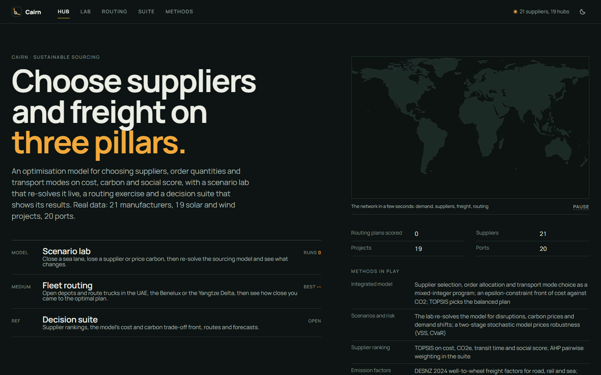
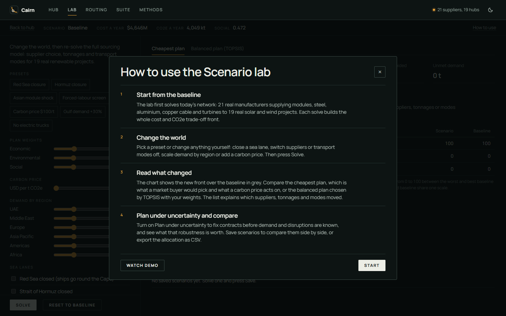
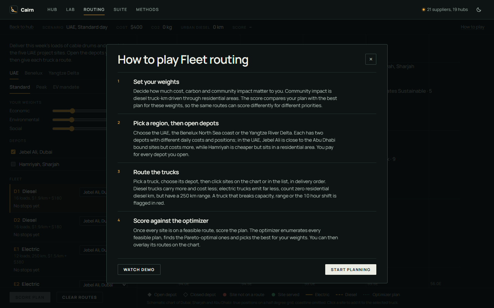
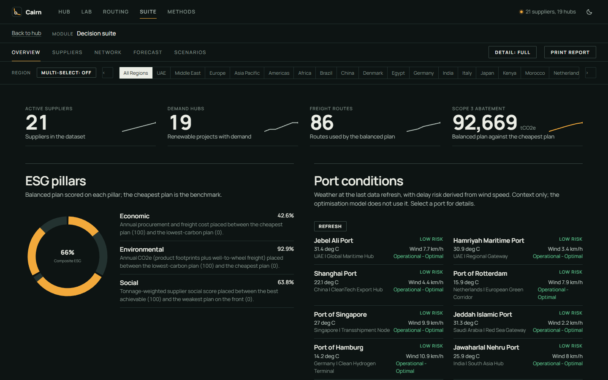
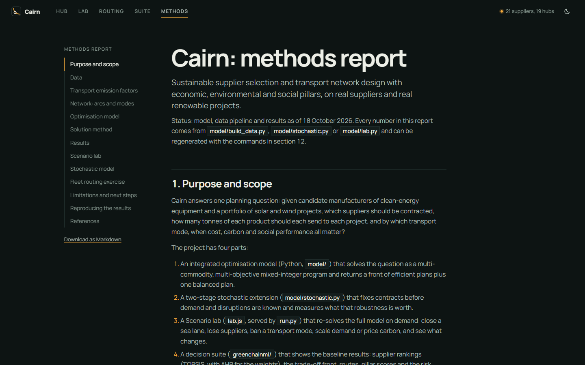

# Cairn — Sustainable Sourcing & Logistics Optimization

[](LICENSE)
[](https://python.org)
[](https://github.com/coin-or/pulp)
[](docs/METHODS.md)

> **Integrated multi-objective mathematical programming, two-stage stochastic optimization, and multi-criteria decision making for sustainable clean-energy equipment procurement and global freight routing.**

Cairn models and optimizes the global supply chain for 19 utility-scale renewable energy projects (totaling **25,610 MW** of solar PV and wind capacity across the UAE, Middle East, Europe, Asia Pacific, the Americas, and Africa). It balances **Cost (USD)**, **Life-Cycle Carbon Emissions ($\text{t CO}_2\text{e}$)**, and **Social Governance Indicators** across 21 real manufacturers in 5 strategic product categories: PV modules, structural steel, primary aluminium, copper cable, and wind turbine assemblies.

---

## Visual Overview & Tour

https://github.com/user-attachments/assets/demo (Video preview: see `docs/brag.mp4` / `intro.mp4`)


*Figure 1: Cairn Hub — supply network topology, Pareto optimal allocations, and multi-pillar trade-offs.*

---

## Core Capabilities

| Capability | Module | Description |
|---|---|---|
| **Multi-Objective MILP** | `model/nexus_model.py` | Multi-commodity Mixed-Integer Linear Program formulated in PuLP and solved via HiGHS. Utilizes the **$\epsilon$-constraint method** to trace the non-dominated Pareto front between procurement/transport cost and well-to-wheel greenhouse gas emissions. |
| **Two-Stage Stochastic Recourse** | `model/stochastic.py` | First-stage contracting decisions fixed before realization of demand shocks, supplier outages, or maritime chokepoint closures. Quantifies the **Value of Stochastic Solution (VSS)**, **Expected Value of Perfect Information (EVPI)**, and **Conditional Value at Risk (CVaR)**. |
| **MCDM Supplier Selection** | `greenchainml/`, `model/` | Multi-Criteria Decision Making using **TOPSIS** (Technique for Order of Preference by Similarity to Ideal Solution) with **AHP** (Analytic Hierarchy Process) weights. Implements non-compensatory social screening (e.g. forced-labor compliance under EU 2024/3015 and US UFLPA). |
| **Interactive Scenario Lab** | `lab.js`, `model/lab.py` | Live re-solving engine accessible through the web UI: simulate carbon tax shocks (\$20–\$200/t), regional demand surges, Red Sea / Bab el-Mandeb closures, and modal freight bans (maritime, rail, diesel truck, electric truck). |
| **Fleet Routing Engine** | `routing.js` | Exact vehicle routing optimization (VRP) for last-mile distribution across regional hubs (UAE depots, Benelux, Yangtze Delta), minimizing road transport emissions and fleet deadhead miles. |
| **Decision Suite** | `greenchainml/` | In-depth analytical workbench: multi-pillar radar charts, supplier tier rankings, route distance matrices, port congestion indices, and verified exportable CSV allocations. |

---

## Interface Gallery

| | |
|---|---|
| <br/>**Scenario Lab**<br/>Live parameter perturbation, Pareto frontier re-computation, and delta KPI tracking. | <br/>**Fleet Routing Workbench**<br/>Exact vehicle route enumeration, payload capacity allocation, and fleet emission profiles. |
| <br/>**Decision Suite & MCDM Scorecard**<br/>Category-by-category TOPSIS rankings, AHP consistency ratios, and risk heatmaps. | <br/>**Exhaustive Methods Documentation**<br/>Complete mathematical formulations, data sources, emission factors, and limitations. |

---

## Mathematical Formulation Overview

### 1. Multi-Objective Mixed-Integer Linear Program (MILP)
The model minimizes total landed cost ($f_1$) subject to parametric bounding of total well-to-wheel emissions ($f_2$):

$$\min \quad f_1(x, y) = \sum_{s} F_s y_s + \sum_{s, p, m, j} \left( c_{s, p}^{\text{prod}} + c_{s, m, j}^{\text{trans}} \right) x_{s, p, m, j}$$

$$\text{subject to} \quad f_2(x) = \sum_{s, p, m, j} \left( e_{s, p}^{\text{prod}} + e_{m}^{\text{trans}} \cdot d_{s, j} \right) x_{s, p, m, j} \le \epsilon_k$$

$$\sum_{s, m} x_{s, p, m, j} = D_{p, j} \quad \forall p \in P, \, j \in J$$

$$\sum_{j, m} x_{s, p, m, j} \le C_{s, p} y_s \quad \forall s \in S, \, p \in P$$

$$y_s \in \{0, 1\}, \quad x_{s, p, m, j} \ge 0$$

Where:
- $y_s$: Binary contract indicator for supplier $s$, with annual contract fixed charge $F_s$.
- $x_{s, p, m, j}$: Tonnage of product $p$ from supplier $s$ to project $j$ via transport mode $m$.
- $D_{p, j}$: Annualized material demand at project $j$ based on JRC capacity intensities.
- $e_m^{\text{trans}}$: DESNZ 2024 well-to-wheel emission factors (maritime, rail, diesel truck, battery-electric truck).

### 2. Multi-Criteria TOPSIS Evaluation
Suppliers within each category are ranked relative to the positive-ideal solution ($A^+$) and negative-ideal solution ($A^-$):

$$C_i^* = \frac{S_i^-}{S_i^+ + S_i^-}, \quad C_i^* \in [0, 1]$$

Where the criteria space spans unit purchase price, Scope 1+2 manufacturing emissions, ISO 45001 certification, safety metrics (lost-time injury frequency), and independent labor auditing.

---

## Getting Started

### Prerequisites
- Python 3.10+ (with `pulp` and `highspy`)
- Node.js 18+ (for local test runner and dashboard serving)

### Quick Setup

```bash
# Clone the repository
git clone https://github.com/NoelMS/Cairn.git
cd Cairn

# Install Python optimization dependencies
pip install -r requirements.txt

# Start the interactive server and web interface
python run.py
```

The application will start the headless optimizer server and open the interface at `http://localhost:8765`.

### Running Verification & Tests

```bash
# Verify the mathematical model and run assertion checks
python model/test_model.py

# Test scenario solving and stochastic calculation
python model/lab.py

# Run browser tests (headless)
npm test
```

---

## Project Structure

```
Cairn/
├── index.html            # Hub, Scenario Lab, and Fleet Routing interface
├── style.css             # Design tokens, layouts, and typography
├── app.js                # Core navigation, data binding, and loop playback
├── lab.js                # Scenario lab client: controls, POST /api/solve, chart canvas
├── routing.js            # Vehicle routing module and Pareto route frontier
├── data.json             # Canonical multi-region supply network dataset
├── run.py                # Server entry point (POST /api/solve, heartbeat, test server)
├── model/
│   ├── nexus_model.py    # MILP formulation, epsilon-constraint, and TOPSIS engine
│   ├── stochastic.py     # Two-stage stochastic model (VSS, EVPI, CVaR)
│   ├── lab.py            # Scenario validation and live re-solve handler
│   ├── build_data.py     # Data pipeline compiling inputs into data.json
│   └── test_model.py     # Unit and scenario verification tests
├── greenchainml/         # Multi-pillar Decision Suite & supplier scorecard
├── docs/
│   ├── METHODS.md        # Comprehensive 300+ line methodology report
│   ├── brag.mp4          # Launch and feature overview video
│   └── screenshots/      # High-resolution application screenshots
└── tests/                # Automated regression test suite
```

---

## License

This project is licensed under the [MIT License](LICENSE).
